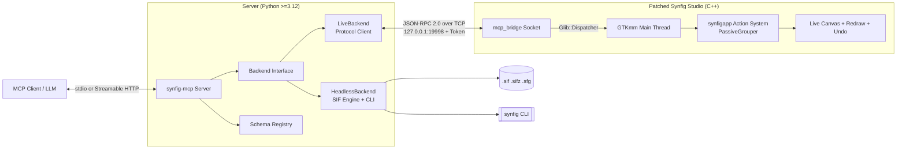

# synfig-mcp

> **Live Model Context Protocol (MCP) control of Synfig Studio (native C++ bridge + headless fallback)**

`synfig-mcp` connects Claude Desktop, Claude Code, Cursor, VS Code, and any MCP-compliant client directly into [Synfig Studio](https://www.synfig.org/). Edits appear on the canvas in real time, are undoable via standard `Ctrl+Z`, and blend safely with manual artist workflows.

---

## Architecture: Dual Backend



1. **LiveBackend (Primary)**: Drives an open, running Synfig Studio using an in-tree C++ bridge. Operations are marshalled to the GTK main loop thread via `Glib::Dispatcher` and executed as undoable `synfigapp::Action`s.
2. **HeadlessBackend (Secondary)**: Pure-Python lossless XML engine (`lxml`) + the `synfig` CLI. Designed for headless servers, CI pipelines, and environments without the patched Studio binary.

---

## Honest Limits & Known Boundaries

- **Live Mode Requirement**: Live interactive editing requires running a patched Synfig Studio binary with `mcp_bridge` enabled.
- **Thread Safety**: Synfig's core and GTKmm GUI are not thread-safe; all mutations are strictly serialized onto the GTK main thread.
- **Sandbox Boundary**: Headless file operations are sandboxed to explicitly configured workspace directories to prevent unauthorized filesystem access.
- **Stock Plugins**: Synfig Studio's stock plugin architecture is file-based only (save $\to$ exit $\to$ script $\to$ reload) and cannot support live pairing; the in-tree bridge is necessary.

---

## Quickstart

### 1. Installation

```bash
uv pip install synfig-mcp
```

### 2. Configure MCP Client (e.g. Claude Desktop)

Add to your `claude_desktop_config.json`:

```json
{
  "mcpServers": {
    "synfig": {
      "command": "uvx",
      "args": ["synfig-mcp"]
    }
  }
}
```

### 3. Verify Health

In your client, invoke `health_check`. It will report whether the Live Studio Bridge or Headless Backend is currently active.

---

## Development & Testing

We use [poethepoet](https://github.com/nat-n/poethepoet) for cross-platform task automation:

```bash
cd server
poe check     # Runs ruff format-check, ruff lint, mypy --strict, and pytest
```

---

## Licensing

- `server/` (Python package): Licensed under the **MIT License**.
- `bridge/` (C++ in-tree patches): Statically linked with Synfig Studio and licensed under the **GNU General Public License v3.0 (GPL-3.0)**.
- See [docs/decisions/ADR-0003-licensing.md](docs/decisions/ADR-0003-licensing.md) for full architectural licensing rationale.
