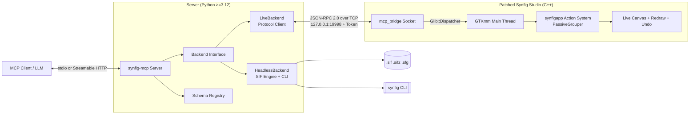

# synfig-mcp

> **Studio-grade Model Context Protocol (MCP) server for Synfig Studio and headless 2D animation pipelines.**

`synfig-mcp` connects Claude Desktop, Claude Code, Cursor, VS Code, and any MCP-compliant AI assistant directly to [Synfig Studio](https://www.synfig.org/). Edits appear on the canvas in real time, are undoable via standard `Ctrl+Z`, and blend safely with manual artist workflows.

---

## Highlights (Studio-Grade Capabilities)

- **Declarative Scene Construction (`scene_build`)**: Build complex multi-layer scenes, hierarchies, waypoints, keyframes, and render targets in a **single atomic undo step** via compact JSON specifications.
- **Visual Review Loop ("Render -> Critique -> Fix")**: Closed-loop visual verification pairing client vision models with objective mathematical analytics (safe-area detection, luminance clipping, photosensitivity strobe warnings, SSIM motion tracking, dominant palette extraction, and diff heatmaps).
- **Effects Recipes & Style Presets**: 14 parameterized visual effect stacks (`speed_lines`, `radial_blur_burst`, `impact_frame`, `slash_arc`, `energy_aura`, `chromatic_aberration`, `halftone_screentone`, etc.) and 5 generic style presets (`shonen_action`, `dark_fantasy`, `supernatural_noir`, `cyber_mecha`, `retro_anime`) built exclusively from native Synfig layers.
- **Cut-Out Characters & Storyboarding**: Automated bone hierarchies, anatomical part bindings, standard pose cycles (`idle`, `walk`, `run`, `punch`, `jump`), and screenplay-to-animatic shot lists.
- **Hardened Licensed Asset Pipeline**: Safe internet asset search and download (Openverse API, Wikimedia Commons) with DNS-resolved SSRF defense, SVG DOM sanitization, raster magic-byte validation, and automated attribution tracking (`ATTRIBUTION.md`).
- **Token Efficiency by Design**: Tool profiles (`core`, `anim`, `fx`, `rig`, `assets`, `review`, `all`) keep tool definitions under tight context budgets (default `core` profile uses only ~2,658 tokens cl100k, an 82.8% reduction from unprofiled baseline).

---

## Architecture: Dual Backend



1. **LiveBackend (Primary)**: Drives an open, running Synfig Studio using an in-tree C++ bridge. Operations are marshalled to the GTK main loop thread via `Glib::Dispatcher` and executed as undoable `synfigapp::Action`s.
2. **HeadlessBackend (Secondary)**: Pure-Python lossless XML engine (`lxml`) + the `synfig` CLI. Designed for headless servers, CI pipelines, and environments without the patched Studio binary.

---

## Tool Profiles & Token Optimization

Configure `SYNFIG_MCP_PROFILE` in your environment or MCP client config:

| Profile | Tools | cl100k Tokens | Description |
|---|---|---|---|
| `core` (default) | 12 | ~2,658 | Atomic declarative builds, inspection, undo/redo, single-frame render. |
| `anim` | 14 | ~3,800 | Keyframing, timeline scrubbing, waypoints, parameter interpolation. |
| `fx` | 21 | ~4,200 | Layer hierarchy, effects recipes, style presets, procedural valuenodes. |
| `rig` | 12 | ~2,800 | Cut-out character rigging, standard poses/motions, storyboards. |
| `assets` | 10 | ~1,900 | Licensed asset search, previews, hardened downloads, local imports. |
| `review` | 15 | ~3,900 | Visual review loop, objective image metrics, contact sheets, render jobs. |
| `all` | 56 | ~18,500 | Unrestricted full access to all tools, low-level schemas, and jobs. |

---

## Documentation & Guides

- [Project Scope & IP Policy](docs/scope.md): Honest capabilities, boundaries, and strict anti-piracy commitments.
- [Architecture Overview](docs/architecture.md): System components, bridge lifecycle, and security model.
- [MCP Tools API Reference](docs/api.md): Complete guide to all tools organized by profile.
- [Effects Recipes & Styles Guide](docs/recipes.md): 14 native anime recipes and 5 generic style presets.
- [Licensed Asset Pipeline](docs/assets.md): Ingest security, SSRF defense, SVG sanitization, and provenance.
- [Synfig Feature Coverage Matrix](docs/COVERAGE.md): Native layer, parameter, valuenode, and target coverage.
- [Token Budget & Benchmarks](docs/TOKEN_BUDGET.md): Token footprint measurements and optimization strategies.
- [Windows Build & Installation](docs/build-windows.md) / [Linux Build](docs/build-linux.md): Compiling the patched Synfig Studio.

---

## Honest Scope & Known Boundaries

- **Live Mode Requirement**: Live interactive editing requires running a patched Synfig Studio binary with `mcp_bridge` enabled.
- **Thread Safety**: Synfig's core and GTKmm GUI are not thread-safe; all mutations are strictly serialized onto the GTK main thread.
- **Strict Sandbox Boundary**: File operations are strictly sandboxed to explicitly configured workspace directories.
- **No Hand-Drawn Anime Generation**: `synfig-mcp` is a precision vector/rigging/compositing tool; it does not replace hand-drawn sakuga animation or run generative diffusion models inside the server.
- **IP Protection**: Zero named copyrighted franchise assets. All presets and recipes use neutral descriptive identifiers.

---

## Quickstart

### 1. Installation

```bash
uv pip install synfig-mcp
```

### 2. Configure MCP Client (e.g. Claude Desktop)

Add to your `claude_desktop_config.json`:

```json
{
  "mcpServers": {
    "synfig": {
      "command": "uvx",
      "args": ["synfig-mcp"],
      "env": {
        "SYNFIG_MCP_PROFILE": "core"
      }
    }
  }
}
```

### 3. Diagnostics & Health

Run the built-in diagnostic suite:

```bash
synfig-mcp doctor
```

In your client, invoke `health_check` to verify whether the Live Studio Bridge or Headless Backend is active.

---

## Development & Testing

We use [poethepoet](https://github.com/nat-n/poethepoet) for cross-platform task automation:

```bash
cd server
poe check     # Runs ruff format-check, ruff lint, mypy --strict, and pytest
poe live      # Runs live e2e tests against running Synfig Studio instance
```

---

## Licensing

- `server/` (Python package): Licensed under the **MIT License**.
- `bridge/` (C++ in-tree patches): Statically linked with Synfig Studio and licensed under the **GNU General Public License v3.0 (GPL-3.0)**.
- See [docs/decisions/ADR-0003-licensing.md](docs/decisions/ADR-0003-licensing.md) for full architectural licensing rationale.
