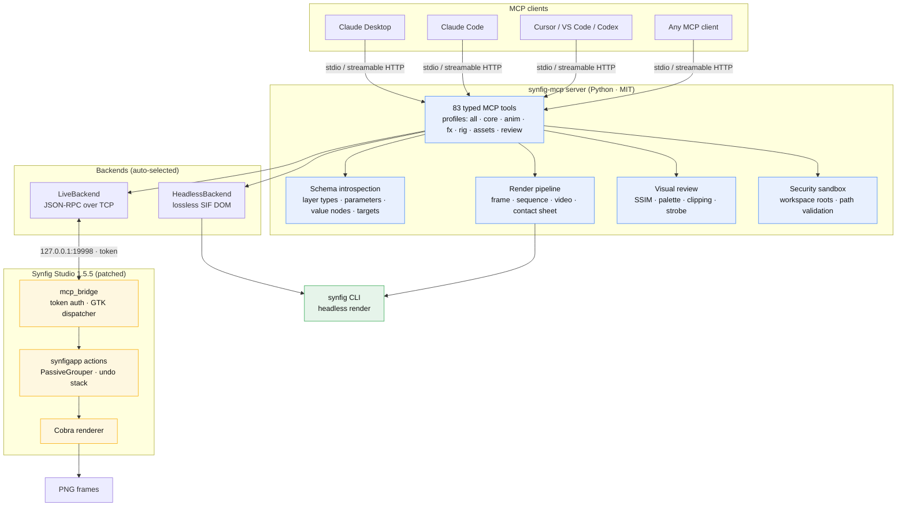
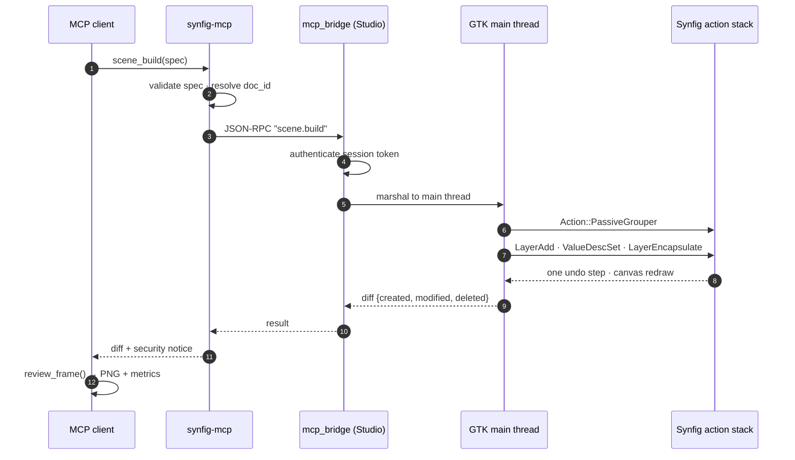
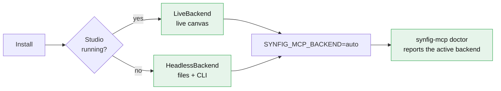
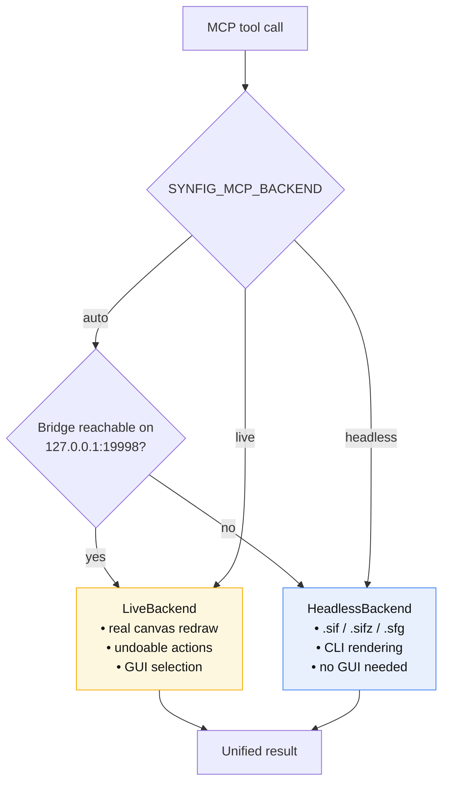
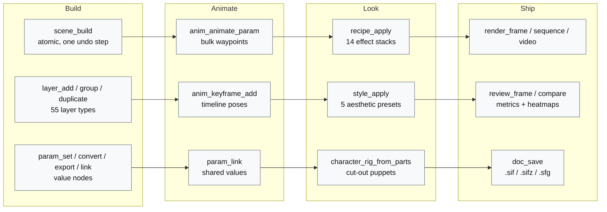
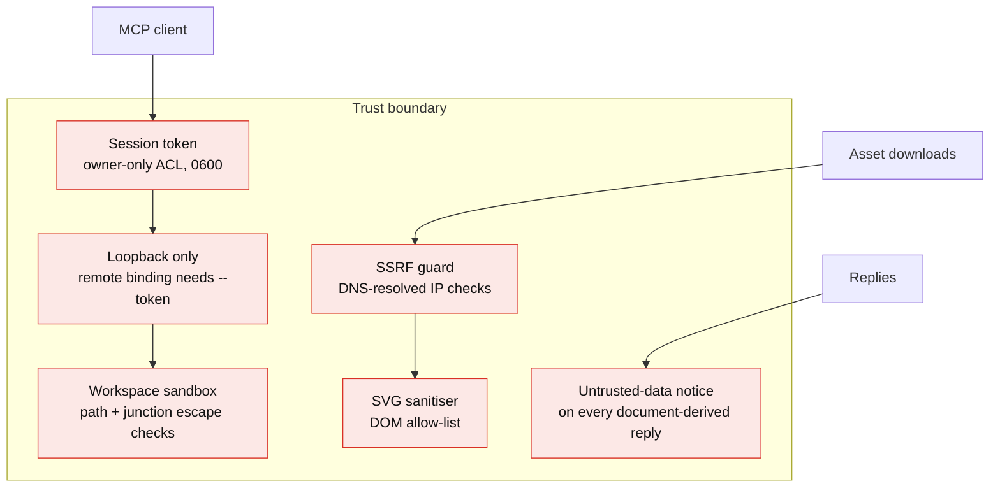
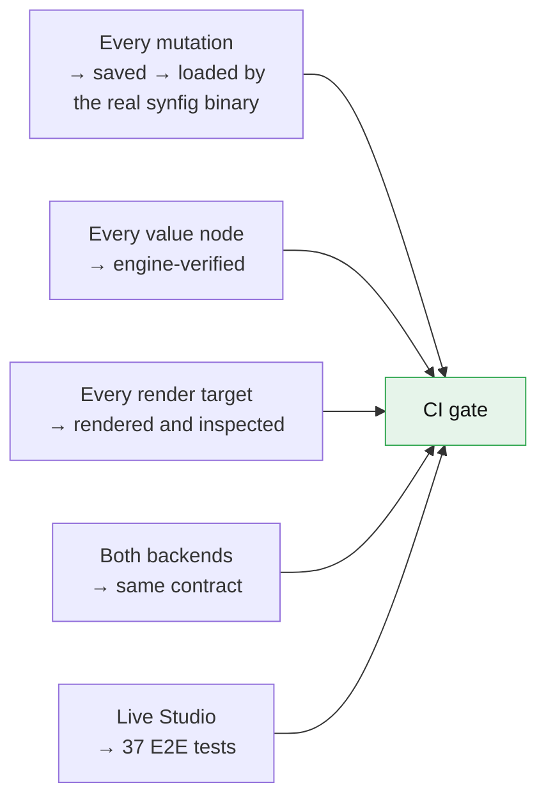

# Synfig MCP

[](https://github.com/anusara-bemal/synfig-mcp/actions/workflows/server-ci.yml)
[](https://github.com/anusara-bemal/synfig-mcp/actions/workflows/bridge-build.yml)
[](https://github.com/anusara-bemal/synfig-mcp/actions/workflows/codeql.yml)
[](https://anusara-bemal.github.io/synfig-mcp/)
[](https://github.com/anusara-bemal/synfig-mcp/actions/workflows/docs.yml)
[](https://github.com/anusara-bemal/synfig-mcp/releases)
[](LICENSE)
[](https://www.python.org/downloads/)
[](https://modelcontextprotocol.io)

**Production-grade Model Context Protocol server for [Synfig Studio](https://www.synfig.org/) — live canvas automation, headless rendering, and AI-assisted 2D animation pipelines.**

**Website:** [anusara-bemal.github.io/synfig-mcp](https://anusara-bemal.github.io/synfig-mcp/) · **Author:** ABM · **License:** MIT (server) / GPL-3.0 (native bridge) · **Tools:** 83 · **Profile:** `all` enabled by default

Synfig MCP connects Claude Desktop, Claude Code, Cursor, VS Code, Codex, and any MCP-compatible client to Synfig Studio. Every edit is applied on the GTK main thread as a regular `synfigapp` action, so it appears instantly on the canvas, takes part in undo/redo, and coexists safely with manual artist work.

---

## Table of contents

- [Why Synfig MCP](#why-synfig-mcp)
- [Architecture](#architecture)
- [How an edit reaches the canvas](#how-an-edit-reaches-the-canvas)
- [Requirements](#requirements)
- [Installation](#installation)
- [Connect an MCP client](#connect-an-mcp-client)
- [Operating modes](#operating-modes)
- [Tool profiles](#tool-profiles)
- [What you can do](#what-you-can-do)
- [Configuration](#configuration)
- [Docker](#docker)
- [Security model](#security-model)
- [How we prove it works](#how-we-prove-it-works)
- [Troubleshooting](#troubleshooting)
- [Development](#development)
- [Documentation](#documentation)
- [License](#license)

---

## Why Synfig MCP?

| | |
|---|---|
| **Live editing** | Drives a running, patched Synfig Studio through an authenticated local bridge. Every mutation is an undoable Studio action. |
| **Headless fallback** | Works without a GUI through a lossless `.sif` / `.sifz` / `.sfg` engine and the `synfig` CLI. Ideal for CI, containers, and render farms. |
| **Complete surface** | All 83 tools ship enabled: every layer type, parameter type, keyframe, value node, render target, effect recipe and review metric. |
| **Rig sheet to scene** | `rig_sheet_slice` cuts a character sheet into parts, `scene_auto_build` assembles jointed characters, background, props, camera and motion (walk, run, wave, jump, ...) in one call and one undo step. See [`docs/characters.md`](docs/characters.md). |
| **Verified output** | Every generated document is loaded by the *real* Synfig engine in CI — a document the engine rejects never passes. |
| **Visual feedback loop** | Renders frames and returns base64 previews plus objective metrics: SSIM, palette, safe areas, clipping, strobe/photosensitivity, diff heatmaps. |
| **Hardened by default** | Token-authenticated bridge, loopback-only binding, sandboxed file access, SSRF-resistant asset downloads, SVG sanitization. |
| **Reproducible releases** | Cross-platform Studio bundles, a GPL source bundle, Python wheel/sdist, SHA-256 checksums, and a CI-published GHCR container. |

---

## Architecture



**Two backends, one tool surface.** `auto` mode picks the live bridge when a patched Studio is listening and falls back to the headless engine otherwise — the model never has to know which one is active, and both are held to the same contract tests.

---

## How an edit reaches the canvas



- **Thread safety** — the bridge never touches Synfig state from the socket thread; a `Glib::Dispatcher` marshals every request onto the GTK main loop.
- **Undo integrity** — all sub-actions of one tool call are grouped, so `history_undo` reverses exactly one MCP call, even when interleaved with manual edits.
- **Fail loudly** — a rejected action returns a typed error instead of a silent no-op.

---

## Requirements

| Component | Requirement |
|---|---|
| Python server | Python **3.12+**, [`uv`](https://docs.astral.sh/uv/) recommended |
| Live mode | Patched Synfig Studio from the [Releases](https://github.com/anusara-bemal/synfig-mcp/releases) page |
| Windows | Windows 10/11 x64 (prebuilt Studio bundle) |
| Linux | x64 with X11/GTK runtime; prebuilt bundle targets Ubuntu 22.04+ / glibc 2.35+ |
| macOS | Python server and headless mode (no prebuilt Studio bridge yet) |
| Headless rendering | `synfig` CLI on `PATH`, or use the container image (it bundles Synfig) |

> A stock Synfig Studio installation **cannot** use live mode — the native bridge is compiled into the bundled Studio builds.

---

## Installation

### Option A — one command (recommended)

```bash
# Linux / macOS
curl -fsSL https://raw.githubusercontent.com/anusara-bemal/synfig-mcp/main/scripts/install.sh | bash

# Windows (PowerShell)
irm https://raw.githubusercontent.com/anusara-bemal/synfig-mcp/main/scripts/install.ps1 | iex
```

The script installs the server with `uv`, verifies the installation with
`synfig-mcp doctor`, and prints the ready-to-paste client configuration.

### Option B — from source

```bash
git clone https://github.com/anusara-bemal/synfig-mcp.git
cd synfig-mcp
cd server && uv sync --all-extras && cd ..
server/.venv/bin/synfig-mcp doctor      # or server\.venv\Scripts\synfig-mcp.exe doctor
```

### Option C — release wheel

```bash
pip install synfig-mcp
synfig-mcp doctor
```

### Run it

```bash
# stdio transport (default, used by MCP clients)
synfig-mcp

# streamable HTTP (remote / container deployments)
synfig-mcp --transport streamable-http --host 127.0.0.1 --port 8000 --token "$SYNFIG_MCP_TOKEN"

# diagnostics
synfig-mcp doctor
```



---

## Connect an MCP client

### Claude Desktop

`claude_desktop_config.json` (`%APPDATA%\Claude\claude_desktop_config.json` on Windows,
`~/Library/Application Support/Claude/` on macOS):

```json
{
  "mcpServers": {
    "synfig": {
      "command": "synfig-mcp",
      "env": {
        "SYNFIG_MCP_PROFILE": "all",
        "SYNFIG_MCP_BACKEND": "auto"
      }
    }
  }
}
```

### Claude Code

```bash
claude mcp add synfig --env SYNFIG_MCP_PROFILE=all -- synfig-mcp
```

### Cursor

```json
{
  "mcpServers": {
    "synfig": {
      "command": "synfig-mcp",
      "env": { "SYNFIG_MCP_PROFILE": "all", "SYNFIG_MCP_BACKEND": "auto" }
    }
  }
}
```

### VS Code

```json
{
  "servers": {
    "synfig": {
      "type": "stdio",
      "command": "synfig-mcp",
      "env": { "SYNFIG_MCP_PROFILE": "all" }
    }
  }
}
```

### Any MCP client (generic JSON)

```json
{
  "mcpServers": {
    "synfig": {
      "command": "/absolute/path/to/synfig-mcp",
      "args": [],
      "env": {
        "SYNFIG_MCP_PROFILE": "all",
        "SYNFIG_MCP_BACKEND": "auto",
        "SYNFIG_MCP_WORKSPACE_ROOTS": "/home/me/Documents/SynfigMCP"
      }
    }
  }
}
```

---

## Operating modes



| Mode | Use it when | Needs |
|---|---|---|
| `auto` *(default)* | Always — picks the best available | nothing extra |
| `live` | The artist is in front of Studio | patched Studio + bridge enabled |
| `headless` | CI, containers, batch rendering | `synfig` CLI on `PATH` |

> **Tip:** in live mode open the patched Studio, enable **Tools → MCP Bridge**, and the model works on the canvas you have selected. Never call `doc_new`/`doc_open` unless the user asked for it.

---

## Tool profiles

All 83 tools are exposed by default. Narrow the surface when the client has a tight context budget:

| Profile | Tools | ≈ tokens (cl100k) | Focus |
|---|---:|---:|---|
| `all` *(default)* | 80 | ~20,100 | Everything: documents, layers, parameters, animation, FX, rigging, review, assets |
| `core` | 13 | ~2,980 | Scene build/export, inspection, undo/redo, single-frame render |
| `anim` | 21 | ~5,000 | Keyframes, timeline, waypoints, interpolation |
| `fx` | 25 | ~6,000 | Layer hierarchy, effect recipes, style presets |
| `rig` | 25 | ~4,500 | Cut-out rigging, poses, motion cycles, storyboards, canvases |
| `assets` | 13 | ~2,800 | Licensed asset search, hardened downloads, attribution |
| `review` | 18 | ~5,200 | Frame/sequence/compare review, objective metrics, jobs |

```bash
SYNFIG_MCP_PROFILE=core synfig-mcp
```

---

## What you can do



- **Every Synfig layer type** — all 55 discovered from the installed binary (`schema_list_layers`), with real parameter names, value types and writability (`schema_get_layer`).
- **Animation** — keyframes, waypoints, every interpolation mode Synfig understands (`linear`, `constant`, `halt`, `clamped`, `auto`, `manual`).
- **Value nodes** — export a value, link another parameter to it, convert a parameter into a procedural node.
- **Effects** — 14 parameterised recipes (speed lines, impact frames, energy auras, film grain, camera shake…) and 5 neutral style presets.
- **Characters** — cut-out puppet assembly, pose presets, motion cycles, storyboard animatics.
- **Rendering** — single frames, sequences, MP4/GIF video, contact sheets, plus the visual review loop.

Full reference: [`docs/tools.md`](docs/tools.md) (all 83 tools) and [`docs/api.md`](docs/api.md).

---

## Configuration

| Environment variable | Default | Description |
|---|---|---|
| `SYNFIG_MCP_PROFILE` | `all` | Tool profile: `all`, `core`, `anim`, `fx`, `rig`, `assets`, `review` |
| `SYNFIG_MCP_BACKEND` | `auto` | `auto`, `live`, or `headless` |
| `SYNFIG_MCP_HOST` | `127.0.0.1` | Bridge host probed in live mode |
| `SYNFIG_MCP_PORT` | `19998` | Bridge TCP port |
| `SYNFIG_MCP_TOKEN_PATH` | `~/.synfig/mcp_token` | Explicit bridge token path |
| `SYNFIG_MCP_WORKSPACE_ROOTS` | `~/Documents/SynfigMCP` | Directories the server may read/write (path-separated) |
| `SYNFIG_MCP_CLI_PATH` | auto-discovered | Explicit path to the `synfig` binary |

---

## Docker

```bash
docker run -i --rm \
  -v "$PWD:/workspace" \
  -e SYNFIG_MCP_WORKSPACE_ROOTS=/workspace \
  ghcr.io/anusara-bemal/synfig-mcp:latest
```

The image ships the Synfig CLI, so headless rendering works out of the box.

---

## Security model



- The bridge binds to `127.0.0.1` only and requires a per-session token stored with owner-only permissions.
- File access is restricted to the configured workspace roots; junctions and symlinks that escape them are rejected.
- Remote binding requires an explicit `--token`.
- Document-derived strings are flagged as untrusted so a model never executes instructions embedded in a layer name.

---

## How we prove it works

Correctness is not asserted, it is **measured against the real Synfig engine**:



| Gate | What it proves | Where |
|---|---|---|
| Document validity | Every mutation produces a file the Synfig engine loads with zero errors | `server/tests/contract/test_sif_synfig_validity.py` |
| Render targets | Each output module's real behaviour (frame / sequence / converter / none) | `server/tests/contract/test_render_targets.py` |
| Backend parity | Headless and Studio answer with the same shapes and semantics | `server/tests/contract/test_backend_parity.py` |
| Wire format | Every type the bridge emits validates against the Python models | `server/tests/unit/test_protocol_models.py` |
| Live E2E | The patched Studio performs the work, undoable, in one step | `server/tests/e2e/` |
| Coverage | The published matrix is generated from measured capability | `docs/COVERAGE.md` |

```bash
cd server
uv run poe check        # format, lint, mypy, unit + contract
uv run poe live         # against a real patched Synfig Studio
```

Verify your own installation end to end (starts the MCP server as a client
would, speaks the protocol over stdio and drives the running Studio):

```bash
python scripts/smoke_live.py
```

---

## Troubleshooting

| Symptom | Cause | Fix |
|---|---|---|
| `Bridge error 2001: Document not found` | No Studio document is open | Open a document in Studio, or create one with `doc_new` |
| Tools fail with "not connected" | Bridge not enabled | Studio → **Tools → MCP Bridge** |
| `render_frame` writes nothing | Target cannot write a single frame | Use `png`, `jpeg`, `bmp`, `gif`, `ppm`, `yuv420p` |
| "Outside the workspace" | Path not under `SYNFIG_MCP_WORKSPACE_ROOTS` | Add the directory, or use the default `~/Documents/SynfigMCP` |
| Slow first layer | Layer catalogue is being introspected | It is cached afterwards; the first run takes ~20 s |

More: [`docs/troubleshooting.md`](docs/troubleshooting.md).

---

## Development

```bash
cd server
uv sync --all-extras
uv run poe check        # format-check, lint, mypy, tests
uv run poe live         # real Studio end-to-end
uv run poe verify-validity   # load every generated document in the real engine
```

Build the patched Studio:

```bash
bash bridge/scripts/build_windows_msys2.sh    # Windows (MSYS2 UCRT64)
bash bridge/scripts/build_linux.sh            # Linux
```

---

## Documentation

| Document | Contents |
|---|---|
| [`docs/tools.md`](docs/tools.md) | All 83 tools with typed parameters |
| [`docs/api.md`](docs/api.md) | Tool surface per profile |
| [`docs/architecture.md`](docs/architecture.md) | Bridge protocol, threading, undo model |
| [`docs/protocol.md`](docs/protocol.md) | JSON-RPC wire format |
| [`docs/COVERAGE.md`](docs/COVERAGE.md) | Measured feature coverage of the Synfig engine |
| [`docs/recipes.md`](docs/recipes.md) | Effect recipes and style presets |
| [`docs/scope.md`](docs/scope.md) | Scope, non-goals and IP policy |
| [`docs/gpl-compliance.md`](docs/gpl-compliance.md) | GPL obligations of the native bridge |

---

## License

**Author: ABM** — with the synfig-mcp contributors.

- The Python **server** (`server/`) is MIT licensed — see [`LICENSE`](LICENSE).
- The native **bridge** (`bridge/`) is compiled into Synfig Studio and is a
  derivative work, therefore **GPL-3.0** — see [`bridge/GPL_NOTICE.txt`](bridge/GPL_NOTICE.txt)
  and [`docs/gpl-compliance.md`](docs/gpl-compliance.md).
- Synfig Studio itself is © the Synfig Project, GPL-3.0.
