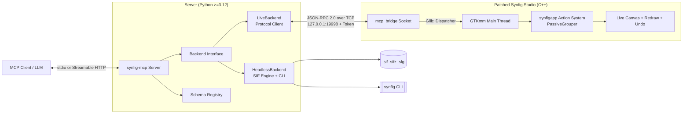

# Architecture Overview

`synfig-mcp` connects LLMs and AI coding assistants (Claude Desktop, Claude Code, Cursor, VS Code) to Synfig Studio and headless animation rendering pipelines.

---

## 1. System Architecture



---

## 2. Core Components & Implementation Status

> [!NOTE]
> **Implementation Status Tracker**:
> - **LiveBackend**: *[Complete]* Communicates via native C++ bridge (`mcp_bridge`) embedded in Synfig Studio with full document, layer, parameter, waypoint, keyframe, and in-process rendering capabilities.
> - **HeadlessBackend**: *[Complete]* Full XML DOM (`lxml`) manipulation and lossless roundtrip with `synfig.exe` CLI rendering.
> - **Protocol Layer**: *[Complete]* Synchronized JSON Schemas, golden fixtures, Pydantic models, async client, and comprehensive contract test suite.

1. **LiveBackend**:
   - Primary backend used when an artist has Synfig Studio open.
   - Communicates via local newline-delimited JSON-RPC 2.0 over `127.0.0.1:19998` with session token auth.
   - Actions are marshalled to the GTK main loop via `Glib::Dispatcher` and grouped in `synfigapp::Action::PassiveGrouper` for atomic undo with `Ctrl+Z`.

2. **HeadlessBackend**:
   - Pure-Python fallback using `lxml` for lossless `.sif` / `.sifz` XML document modification and `synfig` CLI for rendering.
   - Ideal for CI environments, server rendering, batch animation generation, and machines without the patched Studio binary.

3. **Backend Selector**:
   - `auto` mode probes the local bridge socket; automatically falls back to HeadlessBackend if Studio is not running.

---

## 3. Bridge Lifecycle, Port Selection & Multi-Instance Behavior

### Default Startup & Opt-Out Toggle
- **Default State**: Enabled by default. When the patched Synfig Studio launches, the MCP bridge initializes automatically in a background worker thread.
- **Opt-Out Toggle**: Users who wish to run Studio without AI capabilities can set the environment variable:
  ```bash
  export SYNFIG_MCP_DISABLE=1
  # or on Windows:
  set SYNFIG_MCP_DISABLE=1
  ```
  When set, Studio boots normally, skips socket creation, and writes no token file.

### Port Selection & Auto-Probing
- **Default Port**: `127.0.0.1:19998`.
- **Port Override**: Set `SYNFIG_MCP_PORT=<port>` to bind an explicit port.
- **Port Conflict Handling**: If `19998` is already in use, the bridge probes up to 10 sequential ports (`19998` through `20007`) and binds the first available port.

### Session Authentication & Per-PID Tokens
- On startup, the bridge generates a cryptographically secure 256-bit hexadecimal token.
- On Windows, the token file is created with an owner-only Access Control List (ACL) with inheritance removed (`SYSTEM` and built-in Administrators disabled; only the current user SID has Read access).
- To support multiple simultaneous processes without token overwrite races:
  - `~/.synfig/mcp_token`: Holds the token of the most recently initialized instance (for single-instance convenience).
  - `~/.synfig/mcp_token_<pid>`: Holds the PID-specific token for unambiguous multi-instance targeting.

### Single-Instance Gtk::Application Interaction
Upstream Synfig Studio registers itself as a single-instance application via `Gtk::Application("org.synfig.SynfigStudio")`.
When a user launches `synfigstudio.exe` while another is already running on the same desktop session:
1. GTK intercepts the launch.
2. Any command-line file arguments are forwarded to the primary running instance.
3. The secondary process exits cleanly with return code `0` (`"synfig studio is already running; the existing process will be used"`).
4. In multi-user, multi-seat, or containerized environments where multiple primary instances run simultaneously, each instance binds an independent port via auto-probing and writes its own `mcp_token_<pid>`.
