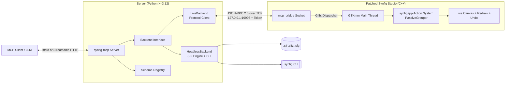

# Architecture Overview

`synfig-mcp` connects LLMs and AI coding assistants (Claude Desktop, Claude Code, Cursor, VS Code) to Synfig Studio and headless animation rendering pipelines.

---

## 1. System Architecture

---

## 2. Core Components

1. **LiveBackend**:
   - Primary backend used when an artist has Synfig Studio open.
   - Communicates via local newline-delimited JSON-RPC 2.0 over `127.0.0.1`.
   - Actions are marshalled to the GTK main loop via `Glib::Dispatcher` and grouped in `synfigapp::Action::PassiveGrouper` for atomic undo with `Ctrl+Z`.

2. **HeadlessBackend**:
   - Pure-Python fallback using `lxml` for lossless `.sif` / `.sifz` XML document modification and `synfig` CLI for rendering.
   - Ideal for CI environments, server rendering, batch animation generation, and machines without the patched Studio binary.

3. **Backend Selector**:
   - `auto` mode probes the local bridge socket; automatically falls back to HeadlessBackend if Studio is not running.
