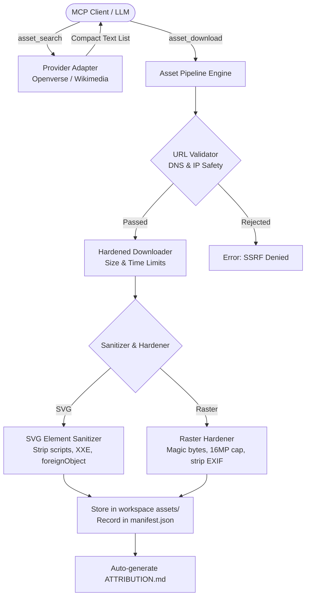

# Licensed Asset Pipeline & Ingest Security

`synfig-mcp` provides a safe, licensed asset pipeline for searching, vetting, downloading, and sanitizing external vector and raster media for animation projects.

---

## 1. Pipeline Overview & Principles



### Core Design Rules:
1. **Token Conservation**: `asset_search` returns compact plain text metadata (ID, title, creator, license, dimensions) without heavy base64 thumbnails to keep context token usage low. Call `asset_preview` only when visual confirmation of a single asset is needed.
2. **License Vetting Before Ingestion**: Assets are verified against configurable project license policies. By default, only non-derivative, commercial-friendly licenses (`cc0`, `pdm`, `by`, `by-sa`) are accepted.
3. **Defense-in-Depth Sanitization**: External SVG and raster files are untrusted inputs. They are strictly validated, defused, and rewritten before touching Synfig or the local file system.

---

## 2. Ingest Security & Threat Mitigation

### Server-Side Request Forgery (SSRF) Defense
- **HTTPS Enforcement**: Only `https://` URLs are accepted. Plain `http://`, `file://`, `data://`, and custom URI schemes are rejected immediately.
- **DNS Resolution & IP Verification**: Before fetching, the server resolves all DNS addresses associated with the hostname. Every resolved IP address is checked against a strict denylist:
  - Loopback (`127.0.0.0/8`, `::1`)
  - Private networks (`10.0.0.0/8`, `172.16.0.0/12`, `192.168.0.0/16`)
  - Link-local addresses (`169.254.0.0/16`, `fe80::/10`)
  - Cloud provider metadata endpoints (e.g., `169.254.169.254`)
  - Multicast and reserved ranges (`224.0.0.0/4`, `240.0.0.0/4`)
- **Hop-by-Hop Redirect Validation**: Redirects are followed manually up to a maximum of 3 hops; every redirect target URL undergoes full DNS resolution and IP verification before the socket connects.

### SVG Sanitization
- **XML Entity Expansion (Billion Laughs) Protection**: Parsed using strict XML safety rules that forbid DTD entities and external entity resolution.
- **Tag Allow-List**: Only safe vector graphic tags (`svg`, `g`, `path`, `rect`, `circle`, `ellipse`, `line`, `polyline`, `polygon`, `linearGradient`, `radialGradient`, `stop`, `defs`, `use`, `clipPath`) are preserved.
- **Defused Danger Elements**: `<script>`, `<iframe>`, `<object>`, `<embed>`, `<audio>`, `<video>`, and `<foreignObject>` elements are purged entirely.
- **Attribute Sanitization**: All inline JavaScript event handlers (`onload`, `onclick`, `onerror`, etc.) and `javascript:` URIs in `href` / `xlink:href` are stripped.

### Raster Image Hardening (PNG / JPEG)
- **Magic Byte Verification**: Formats are validated by magic byte headers (`\x89PNG\r\n\x1a\n` for PNG; `\xff\xd8\xff` for JPEG), never trusting file extensions alone.
- **Decompression Bomb Protection**: Input images are restricted to a maximum resolution ceiling (16 megapixels). Oversized payloads that could exhaust system RAM during decode are rejected.
- **Metadata Scrubbing**: EXIF tags, GPS location data, and embedded author profiles are stripped during ingestion.

---

## 3. Provenance & Attribution

Every ingested asset is assigned a unique identifier (`ast_<uuid>`) and registered in `<workspace>/assets/manifest.json`:

```json
{
  "version": "1.0.0",
  "project_name": "MyAnimation",
  "assets": {
    "ast_98d6c41b": {
      "id": "ast_98d6c41b",
      "source_url": "https://images.openverse.engineering/photos/abc",
      "provider": "openverse",
      "title": "Dramatic Storm Clouds",
      "creator": "Jane Doe",
      "license_code": "by",
      "license_url": "https://creativecommons.org/licenses/by/4.0/",
      "sha256": "4b227777d4dd1fc61c6f884f48641d02b4d121d3fd328cb08b5531fcacdabf8a",
      "retrieved_at": "2026-11-09T00:30:00Z",
      "local_path": "assets/clouds_ast_98d6c41b.png",
      "file_size": 245100,
      "format": "png",
      "rights_declaration": "licensed"
    }
  }
}
```

The pipeline automatically compiles and updates `ATTRIBUTION.md` in the workspace root whenever assets requiring credit (`by`, `by-sa`) are added.

---

## 4. Local Imports & Mandatory Rights Declarations

Users may import their own local vector and raster art using `asset_import_local`. To prevent inadvertent licensing violations, callers must provide a valid `rights` declaration:

- `own`: Original artwork created by the author.
- `licensed`: Commercial or personal license secured from the copyright holder.
- `cc0`: Dedication to the public domain under Creative Commons Zero.
- `public-domain`: Work in the public domain.

Calls without a valid `rights` value are rejected with code `1002 (Invalid Params)`.
