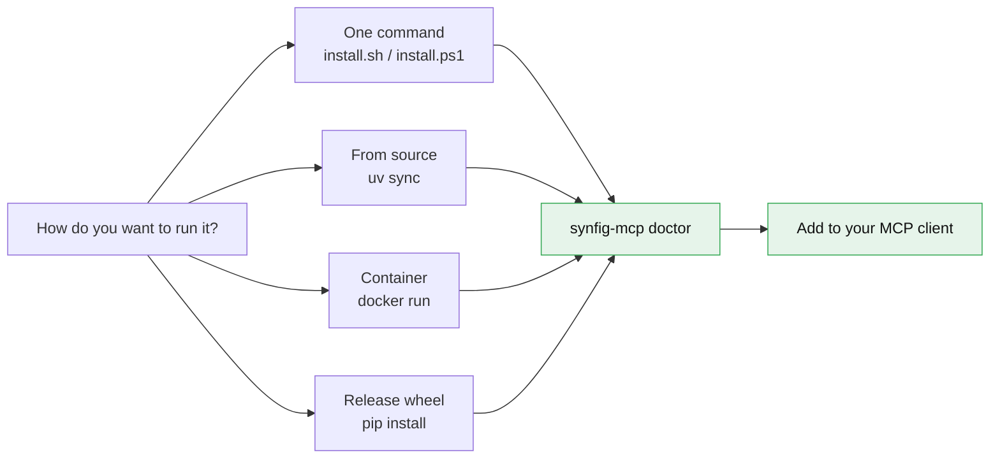
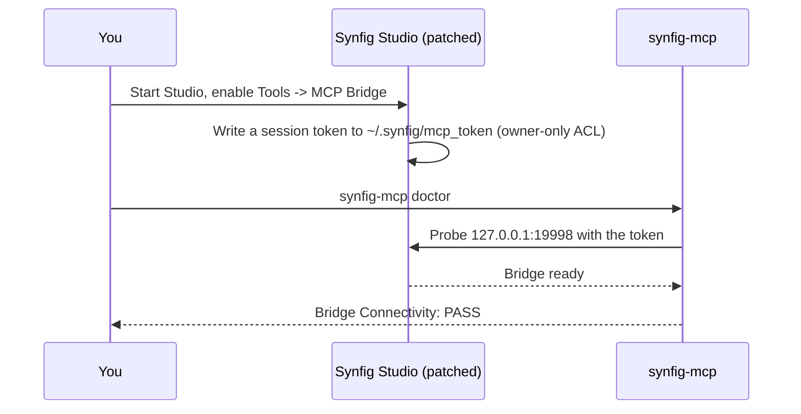
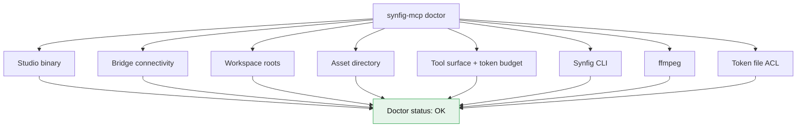

# Installation

Everything below installs the same server; pick the path that matches your setup.



---

## 1. One command (recommended)

### Linux / macOS

```bash
curl -fsSL https://raw.githubusercontent.com/anusara-bemal/synfig-mcp/main/scripts/install.sh | bash
```

### Windows (PowerShell)

```powershell
irm https://raw.githubusercontent.com/anusara-bemal/synfig-mcp/main/scripts/install.ps1 | iex
```

The script

1. checks for Python 3.12+,
2. installs the server with [`uv`](https://docs.astral.sh/uv/) (falling back to `pip`),
3. runs `synfig-mcp doctor` and prints the result,
4. prints the ready-to-paste client configuration.

---

## 2. From source

```bash
git clone https://github.com/anusara-bemal/synfig-mcp.git
cd synfig-mcp/server
uv sync --all-extras
uv run poe check          # format, lint, types, tests
cd ..
server/.venv/bin/synfig-mcp doctor     # Linux / macOS
server\.venv\Scripts\synfig-mcp.exe doctor   # Windows
```

---

## 3. Release wheel

```bash
pip install synfig-mcp
synfig-mcp doctor
```

---

## 4. Container

The image bundles the Synfig CLI, so headless rendering works out of the box.

```bash
docker run -i --rm \
  -v "$PWD:/workspace" \
  -e SYNFIG_MCP_WORKSPACE_ROOTS=/workspace \
  ghcr.io/anusara-bemal/synfig-mcp:latest
```

```bash
# diagnostics inside the container
docker run --rm --entrypoint synfig-mcp ghcr.io/anusara-bemal/synfig-mcp:latest doctor
```

---

## Live mode (patched Synfig Studio)

Headless mode needs nothing but the `synfig` CLI. Live mode additionally needs the
**patched** Studio, because the bridge is compiled into it:

1. Download the bundle for your platform from the
   [Releases](https://github.com/anusara-bemal/synfig-mcp/releases) page.
2. Start `synfigstudio.exe` (or `synfigstudio`).
3. Enable **Tools → MCP Bridge** (the status line in the Tools menu shows
   `MCP Bridge: Active (127.0.0.1:<port> | Commit: …)`).
4. Run `synfig-mcp doctor` - the *Bridge Connectivity* line must turn green.



---

## Client configuration

| Client | File |
|---|---|
| Claude Desktop | `claude_desktop_config.json` (`%APPDATA%\Claude\` on Windows, `~/Library/Application Support/Claude/` on macOS) |
| Claude Code | `claude mcp add synfig --env SYNFIG_MCP_PROFILE=all -- synfig-mcp` |
| Cursor | `~/.cursor/mcp.json` |
| VS Code | `.vscode/mcp.json` |

```json
{
  "mcpServers": {
    "synfig": {
      "command": "synfig-mcp",
      "env": {
        "SYNFIG_MCP_PROFILE": "all",
        "SYNFIG_MCP_BACKEND": "auto"
      }
    }
  }
}
```

---

## Configuration

| Variable | Default | Purpose |
|---|---|---|
| `SYNFIG_MCP_PROFILE` | `all` | Tool profile: `all`, `core`, `anim`, `fx`, `rig`, `assets`, `review` |
| `SYNFIG_MCP_BACKEND` | `auto` | `auto`, `live`, `headless` |
| `SYNFIG_MCP_HOST` | `127.0.0.1` | Bridge host |
| `SYNFIG_MCP_PORT` | `19998` | Bridge port |
| `SYNFIG_MCP_TOKEN_PATH` | `~/.synfig/mcp_token` | Bridge token location |
| `SYNFIG_MCP_WORKSPACE_ROOTS` | `~/Documents/SynfigMCP` | Directories the server may read/write |
| `SYNFIG_MCP_CLI_PATH` | auto-discovered | Explicit path to the `synfig` binary |

---

## Verifying the installation

```bash
synfig-mcp doctor
```



A green report means: the Studio is found, the bridge is reachable (or the
headless fallback is active), the workspace is writable, the CLI and ffmpeg
are present, and the token file has owner-only permissions.

---

## Licensing

- The **server** (`server/`) is MIT licensed — © 2026 **Anusara Bemal** and the
  synfig-mcp contributors.
- The **native bridge** (`bridge/`) is compiled into Synfig Studio and is a
  derivative work, therefore **GPL-3.0** — see
  [`gpl-compliance.md`](gpl-compliance.md).
